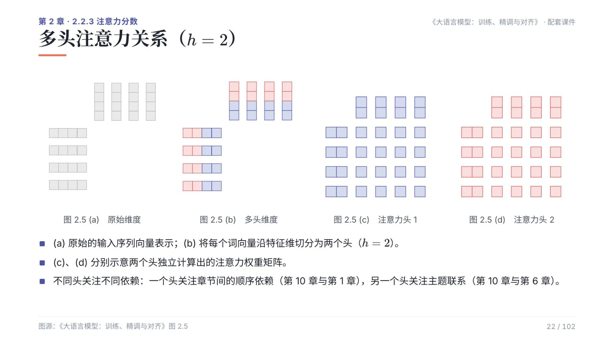

# 示例一：缩放点积注意力与多头切分

对应第 2 章 2.3.1 节。核心只有三行：点积、缩放、softmax，再乘 V。

```bash
python src/transformer/scaled_dot_product_attention.py
python src/transformer/multi_head_attention.py
```

```text
Q 形状: (4, 8, 16, 64)
输出形状: (4, 8, 16, 64)
—— 多头 ——
输入形状: (4, 6, 512)
输出形状: (4, 6, 512)
```

`(4, 8, 16, 64)` 依次是批次、头数、序列长度、单头维度。输出与 V 形状相同——注意力不改变张量形状，只重排信息。

除以 $\sqrt{d}$ 的理由并不显然：$d$ 越大，$QK^\top$ 各元素的方差越大，softmax 越接近 one-hot，梯度越小。缩放把方差拉回常数，这是训练能收敛的前提。

## 多头不是复制

多头不是复制多份完整注意力，而是把词向量沿特征维切开。



上图 $h=2$：原始向量（a）沿特征维一分为二（b），两个头各自算出注意力权重矩阵（c）（d）。因为每个头维度更低，总计算量与单头相当，但能同时关注不同类型的关系。

实现的关键在 `reshape + transpose`：把 `(B, L, D)` 变成 `(B, heads, L, head_dim)`，让头维度进到 batch 旁边，之后所有注意力计算都能按 `(B, H, L, d)` 统一处理。

## 下一步

[回到示例索引](examples.html) · [RMSNorm 与 LayerNorm](examples-rmsnorm.html)
