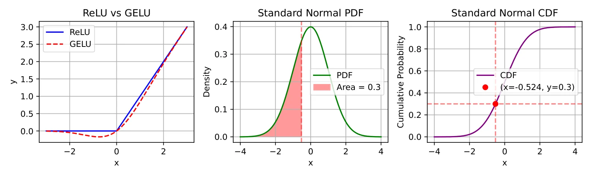

# 示例三：GELU 的三种理解

对应第 3 章。GELU 常写成 $x\cdot\Phi(x)$，即按输入落入标准正态分布的概率加权。

```bash
python src/gpt/gelu.py
```

```text
x 形状: (1000,)
GELU 端点: tensor(-0.0036) tensor(2.9964)
CDF = 0.3 处的分位点: tensor(-0.5244)
该点累积概率: tensor(0.3000)
```



三幅图连起来看：左图是 ReLU 与 GELU 的函数曲线，中图把 GELU 的加权解释画成被积函数的面积，右图是累积分布并标出概率为 0.3 的分位点 $-0.5244$。GELU 在负半轴不是硬截断，而是平滑过渡——这就是它与 ReLU 最直观的区别。

## 三种理解

同一个函数，书里给了三个入口：按正态分布累积概率加权、用 tanh 近似、以及 $\text{GELU}'(x)=\Phi(x)+x\phi(x)$ 这条求导恒等式。三者说的是同一件事，但落到实现上是三种不同的写法。

## 下一步

[RMSNorm 与 LayerNorm](examples-rmsnorm.html) · [NTK-RoPE 的维度分工](examples-ntk-rope.html)
