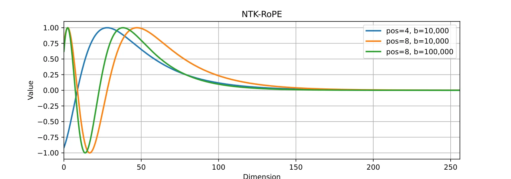

# 示例四：NTK-RoPE 的维度分工

对应第 4 章 4.4 节。长文本外推的一种做法是提高 RoPE 的基频。

```bash
python src/llama/ntk_rope.py
```

```text
pos=4 与 pos=8, b=100k 在全维度的最大偏差: 1.7517
低维区间 (0~64) 的最大偏差: 1.7517
高维区间 (192~256) 的最大偏差: 0.0027
```



差别集中在低维：低维区间偏差 1.75，高维区间只有 0.0027。原因是旋转角度随维度指数递减，低维转得快、高维转得慢。把基频从 10 000 提到 100 000，低维被显著压缩，高维几乎不受影响。NTK 方法正是利用这一点：低维补位置分辨率，高维保住原有精度。

## 下一步

[GELU 的三种理解](examples-gelu.html) · [表格型强化学习的交叉验证](examples-rl-tabular.html)
