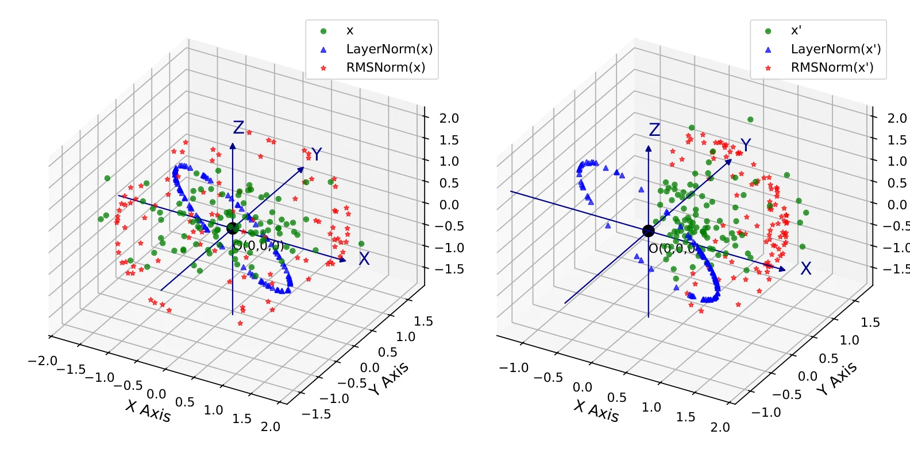

# 示例二：RMSNorm 与 LayerNorm 的差别

对应第 4 章 4.2.2 节。两者都做缩放，但 LayerNorm 还要减均值。

```bash
python src/llama/rmsnorm.py
```

```text
输入形状: (100, 3)
原始数据均值: [ 0.5235  0.4546  0.1045]
LayerNorm 均值: [ 0.2888  0.1907 -0.4795]
RMSNorm 均值:   [ 0.9290  0.8493  0.1021]
```

结果很直白：LayerNorm 把各维均值压到 0 附近，RMSNorm 保留原方向，只改模长。这就是“重中心化不变性”在数值上的样子。



左图是无结构随机点，右图是有结构的点云。绿色是原始数据，蓝三角是 LayerNorm 后，红点是 RMSNorm 后。可以清楚看到：LayerNorm 把点云拉向原点并压扁，RMSNorm 只是把整体缩放到单位球附近，方向保留。

## 书里推了四页

书中用四页推这件事：先给均方根、缩放与可学习因子三个式子，再把输入缩放 $\alpha$ 倍、权重缩放分别推一遍输出如何变化，最后推反向传播的梯度形态。实测收尾：WMT14 英德翻译 BLEU 提升 0.3，计算快 10%–30%。

这三步在[主页“课本内容”](../../index.html#book-content)一节里有展开。

## 下一步

[缩放点积注意力](examples-attention.html) · [GELU 的三种理解](examples-gelu.html)
